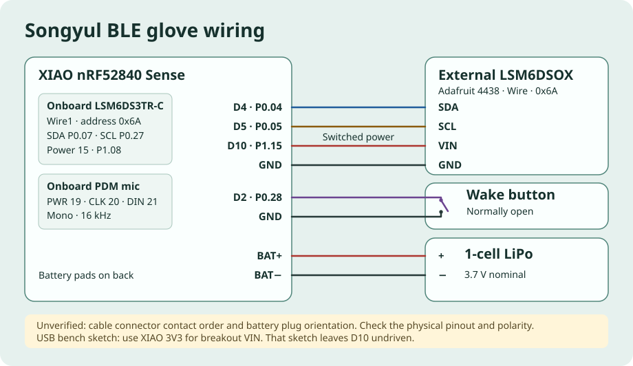

# Wiring

The drawing follows the BLE glove sketch. Its external LSM6DSOX breakout is powered by D10 (P1.15), which the firmware drives and can cycle during I²C recovery. This is the wiring for the tested Adafruit 4438 breakout. For the separate USB bench sketch, connect the breakout VIN to 3V3 because that sketch leaves D10 undriven.

The XIAO's built-in IMU and PDM mic require no external wires. Pin labels are from the BLE sketch, `fast_i2c.h`, and the XIAO nRF52840 Sense variant in Seeed mbed 2.9.3. The cable connector's contact order and the battery plug orientation are unspecified in firmware. Confirm them against the label or pinout of the physical parts and verify polarity before connecting power.

Songyul documentation and diagrams in this folder use [CC BY-NC-SA 4.0](../LICENSE-CAD-DOCS). Credit Songyul when sharing them or adaptations.
